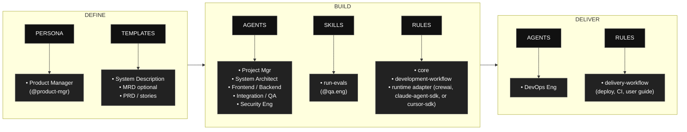

# AAMAD – AI-Assisted Multi-Agent Application Development Framework

**AAMAD** is an open, production-grade framework for building, deploying, and evolving multi-agent applications using best context engineering practices.  
It systematizes research-driven planning, modular AI agent workflows, and rapid MVP/devops pipelines for enterprise-ready AI solutions.

---

## Table of Contents

- [What is AAMAD?](#what-is-aamad)
- [What AAMAD is not](#what-aamad-is-not)
- [Principles and benefits](#principles-and-benefits)
- [Core Concepts](#core-concepts)
- [AAMAD phases at a glance](#aamad-phases-at-a-glance)
- [Installation](#installation)
- [Using AAMAD in your IDE](#using-aamad-in-your-ide)
- [Repository Structure](#repository-structure)
- [Runtime adapters](#runtime-adapters)
- [How to Use the Framework](#how-to-use-the-framework)
- [Phase 1: Define Workflow (Product Manager)](#phase-1-define-stage-product-manager)
- [Phase 2: Build Workflow (Multi-Agent)](#phase-2-build-stage-multi-agent)
- [Phase 3: Deliver Stage (DevOps)](#phase-3-deliver-stage-devops)
- [Contributing](#contributing)
- [License](#license)

---

## What is AAMAD?

AAMAD is a context engineering framework based on best practices in AI-assisted coding and multi-agent system development methodologies.  
It enables teams to:

- Launch projects with autonomous or collaborative AI agents
- Rapidly prototype MVPs with clear context boundaries
- Use production-ready architecture/design patterns
- Accelerate delivery, reduce manual overhead, and enable continuous iteration

In AAMAD, the development crew (personas, rules, templates, and artifacts) is the stable methodology.  
Runtime adapters are an implementation choice for what backend runtime your generated MVP targets.

You can use AAMAD across multiple development environments: see [Using AAMAD in your IDE](#using-aamad-in-your-ide) for Cursor, Claude Code, VS Code + GitHub Copilot, and Kiro.

---

## What AAMAD is not

- AAMAD is not a programmatic runtime orchestrator for its own Define → Build → Deliver phases.
- Runtime adapter selection does not change AAMAD phase orchestration; it only changes the runtime conventions used by Build-phase implementation personas.
- Headless orchestration of AAMAD phases remains out of scope (see current release notes / changelog).

---

## Principles and benefits

AAMAD changes “vibe coding” from ad-hoc prompting into a **context-first, persona-driven** workflow:

- **Single-responsibility personas** own clear epics (Define → Build → Deliver) with explicit inputs, outputs, and prohibited actions.
- **Artifacts over chat memory:** PRD, SAD, and phase docs under `project-context/` make decisions auditable and reproducible.
- **Runtime adapters are an implementation choice** (`AAMAD_TARGET_RUNTIME`), not the methodology itself.
- **Quality gates** (required headings, optional `aamad validate`, QA → security → deliver) keep MVP scope honest.

**Benefits you can expect:** clearer requirements before code, less rework from underspecified prompts, traceable handoffs between agents, and documentation that stays useful when you re-sync after code changes.

---

## Core Concepts

- **Persona-driven development:** Each workflow is owned and documented by a clear AI agent persona with a single responsibility principle.
- **Context artifacts:** All major actions, decisions, and documentation are stored as markdown artifacts, ensuring explainability and reproducibility.
- **Quality gates:** Required artifact headings, optional `aamad validate`, and QA → evals → security → deliver sequencing.
- **Evals as acceptance criteria:** Measurable success thresholds (accuracy, latency, safety, security, cost) defined before Build in the SAD and implemented as a golden-dataset eval suite (`*run-evals`) that gates future model/prompt changes.
- **Project configuration:** Optional `aamad.config.yml` for shared language, UI, testing, and security preferences across personas.
- **Documentation sync:** After enhancing generated code, use `prompt-sync-docs` so `project-context/` stays aligned with the implementation.
- **Parallelizable epics:** Big tasks are broken into epics, making development faster and more autonomous while retaining control over quality.
- **Reusability:** Framework reusable for any project—simply drop in your PRD/SAD and let the agents execute.
- **Open, transparent, and community-driven:** All patterns and artifacts are readable, auditable, and extendable.

---

## AAMAD phases at a glance

AAMAD organizes work into three phases: Define, Build, and Deliver, each with clear artifacts, personas, and rules to keep development auditable and reusable. 
The flow begins by defining context and templates, proceeds through multi‑agent build execution, and finishes with operational delivery.



- **Phase 1 (Define):** Product Manager persona (`@product-mgr`) conducts structured elicitation (recommended), optional MRD for commercial products, and PRD/user stories to standardize project scoping.

- **Phase 2 (Build):** Multi‑agent execution by Project Manager, System Architect, Frontend Engineer, Backend Engineer, Integration Engineer, QA Engineer (unit + integration stages), and (recommended) Security Engineer, governed by core/development-workflow rules and the selected runtime adapter rule.

- **Phase 3 (Deliver):** DevOps Engineer (`@devops.eng`) packages the validated MVP using the `delivery-workflow` rule; artifacts include `project-context/3.deliver/deploy.md` and optionally `user-guide.md`.

---

## Installation

Install AAMAD from PyPI and initialize the framework for your IDE:

```bash
pip install aamad
# or
uv pip install aamad
```

### Multi-IDE support

AAMAD supports **Cursor**, **Claude Code**, **VS Code + GitHub Copilot**, and **Kiro**. Run `aamad init` and choose a development environment from the prompt, or pass `--ide` to skip it:

```bash
aamad init                     # Prompt: Cursor, Claude Code, VS Code with GitHub Copilot, Kiro
aamad init --ide cursor        # Cursor
aamad init --ide claude-code  # Claude Code
aamad init --ide vscode       # VS Code + GitHub Copilot
aamad init --ide kiro         # Kiro
```

#### Framework feature implementation by IDE

| Feature | Cursor | Claude Code | VS Code + Copilot | Kiro |
| :------ | :----- | :---------- | :---------------- | :--- |
| **Rules / instructions** | `.cursor/rules/*.mdc` with `alwaysApply: true` | `.claude/CLAUDE.md` + `.claude/rules/*.md` | `.github/instructions/*.instructions.md` | `.kiro/steering/*.md` with `inclusion: always` |
| **Rule format** | `.mdc` (YAML frontmatter + markdown body) | `.md` (plain markdown) | `.instructions.md` (`applyTo`, `name`, `description`) | `.md` (steering frontmatter + markdown body) |
| **Glob-based scoping** | ✅ `globs:` in frontmatter | ❌ Not supported (all rules loaded) | ✅ `applyTo:` in frontmatter | ✅ `inclusion: fileMatch` (AAMAD rules use `always`) |
| **Agent definitions** | `.cursor/agents/*.md` | `.claude/agents/*.md` | `.github/agents/*.agent.md` | `.kiro/agents/*.md` |
| **Agent invocation** | `@agent-name` in chat | Delegation via `description`; explicit request | Agent dropdown; `@agent-name`; handoff buttons | Agent picker in the chat pane |
| **Tool enforcement** | Instructions-based | ✅ Hard allowlist/denylist | ✅ Tool allowlist in frontmatter | ✅ Tool list in agent frontmatter |
| **Phase 1 prompt** | `.cursor/prompts/prompt-phase-1` | `.claude/commands/phase-1-define.md` (slash command) | `.github/prompts/phase-1-define.prompt.md` | `.kiro/steering/phase-1-define.md` (manual steering / slash command) |
| **Skills** | `.cursor/skills/run-evals/` | `.claude/skills/run-evals/` (native skills) | `.github/prompts/run-evals.prompt.md` (bound to `qa-eng`; no native skills primitive) | `.kiro/skills/run-evals/` (native Agent Skills) |
| **Templates** | `.cursor/templates/` | `.claude/templates/` | `.github/templates/` | `.kiro/templates/` |
| **Project context** | `project-context/` (shared) | `project-context/` (shared) | `project-context/` (shared) | `project-context/` (shared) |
| **Bridge file** | `AGENTS.md` (root) | `AGENTS.md` (root) | `AGENTS.md` (root) | `AGENTS.md` (root) |

---

### Cursor

**Install and initialize:**

```bash
python -m venv .venv
source .venv/bin/activate   # Windows: .venv\Scripts\activate
pip install aamad
aamad init --ide cursor --dest .
```

Or with uv:

```bash
uv venv
uv pip install aamad
uv run aamad init --ide cursor --dest .
```

**Folder structure after init:**

```
your-project/
├── .cursor/
│   ├── agents/          # Persona definitions (@product-mgr, @backend.eng, etc.)
│   ├── prompts/         # Phase-specific prompts (e.g. prompt-phase-1)
│   ├── rules/           # Always-on rules (*.mdc)
│   ├── skills/          # Agent skills (e.g. run-evals)
│   └── templates/      # PRD, SAD, MR templates
├── project-context/
│   ├── 1.define/        # MRD, PRD, SAD outputs
│   ├── 2.build/         # setup.md, frontend.md, backend.md, etc.
│   └── 3.deliver/       # deploy runbook and configs
├── AGENTS.md            # Bridge file (IDE discoverability)
├── CHECKLIST.md
└── README.md
```

---

### Claude Code

**Install and initialize:**

```bash
python -m venv .venv
source .venv/bin/activate
pip install aamad
aamad init --ide claude-code --dest .
```

Or with uv:

```bash
uv venv
uv pip install aamad
uv run aamad init --ide claude-code --dest .
```

**Folder structure after init:**

```
your-project/
├── .claude/
│   ├── CLAUDE.md        # Rules summary + cross-references
│   ├── agents/          # Persona definitions (Claude Code format)
│   ├── commands/        # Slash commands (e.g. phase-1-define)
│   ├── rules/           # Individual rule files (*.md)
│   ├── skills/          # Agent skills (e.g. run-evals, native Claude Code skills)
│   ├── templates/       # PRD, SAD, MR templates
│   └── settings.json    # Permissions, AAMAD_TARGET_RUNTIME env
├── project-context/
│   ├── 1.define/
│   ├── 2.build/
│   └── 3.deliver/
├── AGENTS.md
├── CHECKLIST.md
└── README.md
```

---

### VS Code + GitHub Copilot

**Install and initialize:**

```bash
pip install aamad
aamad init --ide vscode --dest .
```

Or with uv:

```bash
uv pip install aamad
uv run aamad init --ide vscode --dest .
```

**Folder structure after init:**

```
your-project/
├── .github/
│   ├── instructions/   # Copilot instructions (*.instructions.md)
│   ├── agents/         # Custom agents (*.agent.md) with optional handoffs
│   ├── prompts/        # Phase 1 prompt, sync-docs, run-evals (phase-1-define.prompt.md, ...)
│   └── templates/      # PRD, SAD, MR templates
├── .vscode/
│   └── settings.json   # chat.instructionsFilesLocations, chat.agentFilesLocations
├── project-context/
│   ├── 1.define/
│   ├── 2.build/
│   └── 3.deliver/
├── AGENTS.md
├── CHECKLIST.md
└── README.md
```

**Required extensions:** GitHub Copilot, GitHub Copilot Chat. Recommended: Python (ms-python), YAML (redhat).

---

### Kiro

**Install and initialize:**

```bash
pip install aamad
aamad init --ide kiro --dest .
```

Or with uv:

```bash
uv pip install aamad
uv run aamad init --ide kiro --dest .
```

**Folder structure after init:**

```
your-project/
├── .kiro/
│   ├── agents/          # Persona definitions (Kiro custom agents)
│   ├── steering/        # Always-on rules + manual Phase 1 / sync-docs prompts
│   ├── skills/          # Agent skills (e.g. run-evals)
│   └── templates/       # PRD, SAD, MR templates
├── project-context/
│   ├── 1.define/
│   ├── 2.build/
│   └── 3.deliver/
├── AGENTS.md
├── CHECKLIST.md
└── README.md
```

Switch personas from the agent picker in the chat pane. Manual steering files (`phase-1-define`, `sync-docs`) appear as slash commands.

---

### Using AAMAD in your IDE

How you interact with AAMAD depends on your IDE. The framework produces the same artifacts (`project-context/`, templates, Phase 1 prompt); only rules and agent scaffolding differ.

#### Workflow and context (per IDE)

| What you do | Cursor | Claude Code | VS Code + Copilot | Kiro |
| :---------- | :----- | :---------- | :---------------- | :--- |
| **Start a fresh context** (e.g. new module) | `Cmd+Shift+P` → **New Chat** | `/clear` or start a new session | Start a new chat session | Start a new chat session |
| **Invoke a persona** | Type `@backend.eng` (or other agent) in chat | Ask to use the subagent by name, or refer to its description | Pick the agent from the dropdown, or use `@agent-name` | Pick the agent from the chat pane picker |
| **Reference a file** | `@path/to/file` in chat | `@path/to/file` in the prompt | `#file:path/to/file` or drag-and-drop the file | `#file` references or attach from the workspace |
| **Phase transitions** (Define → Build → Deliver) | Switch persona manually in chat | Use subagent chaining or explicit instructions | Use **handoff** buttons in the chat UI (when configured) | Switch persona from the agent picker |

#### Capability comparison

| Capability | Cursor | Claude Code | VS Code + Copilot | Kiro |
| :--------- | :----- | :---------- | :---------------- | :--- |
| **AAMAD support** | Native | Via `aamad init --ide claude-code` | Via `aamad init --ide vscode` | Via `aamad init --ide kiro` |
| **Glob-based rule scoping** | Yes | No (all rules loaded) | Yes (`applyTo:` in instructions) | Yes (`inclusion: fileMatch`; AAMAD rules use `always`) |
| **Tool enforcement** | Instructions only | Hard allowlist/denylist | Tool allowlist in agent frontmatter | Tool list in agent frontmatter |
| **Agent handoffs** | Manual | Manual or subagent chaining | Native UI buttons (Define → Build → Deliver) | Manual (agent picker) |
| **Parallel work** | Multiple chat tabs | Subagents / Agent Teams | Subagents | Workflows / custom agents |
| **Model choice** | Multi-model | Claude models | Multi-model (GPT, Claude, Gemini, etc.) | Multi-model |
| **Best for** | AAMAD as designed | CLI-first, solo use | Teams, enterprise, model diversity | Spec-driven and steering-first workflows |

#### What is the same in all IDEs

These are **IDE-agnostic** — no change when you switch:

- **`project-context/`** — Directory layout and all Phase 1/2/3 outputs (MRD, PRD, SAD, setup.md, frontend.md, backend.md, integration.md, qa.md).
- **Templates** — Same PRD, SAD, and MR files, stored in the IDE folder (`.cursor/templates/`, `.claude/templates/`, `.github/templates/`, or `.kiro/templates/`).
- **Phase 1 prompt** — Usable in any AI chat; same content in Cursor prompts, Claude Code commands, or VS Code prompts.
- **Crew logic and artifacts** — The same persona/rules/templates methodology regardless of IDE.
- **Git and dependency setup** — Same repo and `pyproject.toml` workflow.

What **does** change per IDE: where rules, agents, and templates live (`.cursor/`, `.claude/`, `.github/`, or `.kiro/`) and how you invoke personas and reference files (see table above).

Upgrading a Claude Code, VS Code, or Kiro project from 0.9.0 or earlier: run `aamad init --overwrite --ide <claude-code|vscode|kiro>`. If the project is not using Cursor, delete leftover `.cursor/` afterward.

---

**CLI flags:**

- `--dest PATH` — Output directory (default: current directory)
- `--ide {cursor,claude-code,vscode,kiro}` — Target IDE. Omit on `init` to choose interactively.
- `--overwrite` — Allow replacing existing files
- `--dry-run` — Preview what would be written

Inspect bundle contents: `aamad bundle-info --verbose` or `aamad bundle-info --ide claude-code`. For `--ide vscode` and `--ide kiro`, artifacts are generated from the Cursor bundle (no separate bundle).

---

## Repository Structure

    aamad/
    ├─ .cursor/
    │   ├─ agents/       # Agent persona definitions
    │   ├─ prompts/      # Phase-specific prompts
    │   ├─ rules/        # Architecture, workflow, epics rules
    │   ├─ skills/        # Agent skills (e.g. run-evals)
    │   └─ templates/    # PRD, SAD, MR templates
    ├─ project-context/
    │   ├─ 1.define/     # PRD, SAD, research reports
    │   ├─ 2.build/      # Setup, frontend, backend, integration, QA, evals
    │   └─ 3.deliver/    # deploy runbook and configs
    ├─ docs/
    ├─ CHECKLIST.md
    └─ README.md

**Framework artifacts** in `.cursor/` are the source for both Cursor and Claude Code bundles.  
**Project-context** is IDE-agnostic and shared across all IDEs.

---

## Runtime adapters

Use `AAMAD_TARGET_RUNTIME` to choose the runtime target for the generated multi-agent application in Phase 2:

| Runtime | Status | Best fit |
| :------ | :----- | :------- |
| `crewai` | Default | Declarative task orchestration with YAML-first runtime configuration |
| `claude-agent-sdk` | Supported | Agentic runtime harness with hooks, MCP, and session control |
| `cursor-sdk` | Supported | TypeScript-first Cursor runtime integration with explicit tool/runtime contracts |

---

## How to Use the Framework

1. **Install** (recommended): `pip install aamad` then `aamad init` (or `aamad init --ide <cursor|claude-code|vscode|kiro>`)
2. **Optional project config:** copy `aamad.config.example.yml` → `aamad.config.yml` and set language, UI, testing, and security preferences.
3. **Select runtime target** for Phase 2 (for example `AAMAD_TARGET_RUNTIME=crewai`, `AAMAD_TARGET_RUNTIME=claude-agent-sdk`, or `AAMAD_TARGET_RUNTIME=cursor-sdk`).
4. Confirm your IDE has the full agent, prompt, and rule set.
5. Follow `CHECKLIST.md` for the Define → Build → Deliver workflow (start Phase 1 with `*elicit-requirements` when the use case is specialized).
6. Each agent persona executes its epic(s), producing markdown artifacts and code.
7. Run `aamad validate --phase define|build|deliver` at phase gates to check required artifacts and Audit headings.
8. Review, test, and launch the MVP. After code changes that drift from docs, use `.cursor/prompts/prompt-sync-docs` (Claude Code: `/sync-docs`) to resynchronize `project-context/`.

---

## Phase 1: Define Stage (Product Manager)

The Product Manager persona (`@product-mgr`) conducts discovery and context setup to standardize project scoping:

- **Elicitation (recommended):** Structured questionnaire → `system-description.md` via `*elicit-requirements`
- **Market Research (optional):** MRD using the `mrd-template.md` in your IDE templates folder for commercial products; skip for internal/personal tools
- **Requirements:** PRD using the `prd-template.md` in your IDE templates folder
- **User stories:** MVP stories for architecture and QA traceability
- **Project config:** Optional `aamad.config.yml` for language, UI, testing, and security defaults
- **Validation:** Run `aamad validate --phase define` when artifacts exist

Phase 1 outputs are stored in `project-context/1.define/` and provide the foundation for all subsequent development phases.

---

## Phase 2: Build Stage (Multi-Agent)

Each role is embodied by an agent persona, defined in `.cursor/agents/` (Cursor), `.claude/agents/` (Claude Code), or `.github/agents/` (VS Code).  
Before implementation, set `AAMAD_TARGET_RUNTIME` to the target backend runtime (`crewai` default, `claude-agent-sdk` supported, `cursor-sdk` supported).
Phase 2 is executed by running each epic in sequence after completing Phase 1:

- **Architecture:** Generate solution architecture document (`sad.md`), including eval criteria via `*define-eval-criteria` (accuracy, latency, safety, security, cost thresholds in SAD §9)
- **Setup:** Scaffold environment, install dependencies, and document (`setup.md`)
- **Frontend:** Build UI + placeholders, document (`frontend.md`)
- **Backend:** Implement backend for the selected runtime, document (`backend.md`)
- **Integration:** Wire up chat flow, verify, document (`integration.md`)
- **Quality Assurance:** Run `*test-unit` and `*test-integration`, then smoke/acceptance (`*qa`); map tests to acceptance-criteria IDs when present; log in `qa.md`
- **Evals (recommended):** `*run-evals` — golden dataset, code-based checks, LLM-as-judge scoring, and production monitoring recommendations for DevOps; logged in `evals.md`. Already past QA on an existing project? Run `*run-evals` directly — it asks you for any missing thresholds instead of blocking (see `.cursor/skills/run-evals/`).
- **Security (recommended):** `@security.eng` → `security.md` before Deliver (required when `aamad.config.yml` sets `security.require_security_assessment: true`)

Artifacts are versioned and stored in `project-context/2.build` for traceability.

---

## Phase 3: Deliver Stage (DevOps)

After QA (and preferably security), invoke `@devops.eng`:

- **Release readiness:** Confirm `qa.md` (and note `evals.md` and `security.md` status)
- **Deploy / CI:** Minimal deploy and pipeline config aligned with SAD and `AAMAD_TARGET_RUNTIME`, incorporating `evals.md`'s Production Monitoring Recommendations (trace fields, dashboards, alert thresholds)
- **Runbook:** `project-context/3.deliver/deploy.md` (hosting, env matrix, access, rollback)
- **User docs:** `*document-user-guide` → `project-context/3.deliver/user-guide.md`
- **Validate:** `aamad validate --phase deliver`

---

## Contributing

Contributions are welcome!  
- Open an issue for bugs/feature ideas/improvements.
- Submit pull requests with extended templates, new agent personas, or bug fixes.
- Help evolve the knowledge base and documentation for greater adoption.
- When modifying `.cursor/` or `project-context/`, run `python scripts/update_bundle.py` to refresh both Cursor and Claude Code bundles before publishing.

---

## License

Licensed under Apache License 2.0.

> Why Apache-2.0
>    Explicit patent grant and patent retaliation protect maintainers and users from patent disputes, which is valuable for AI/ML methods, agent protocols, and orchestration logic.
>    Permissive terms enable proprietary or closed-source usage while requiring attribution and change notices, which encourages integration into enterprise stacks.
>    Compared to MIT/BSD, Apache-2.0 clarifies modification notices and patent rights, reducing legal ambiguity for contributors and adopters.

---

> For detailed step-by-step Phase 2 execution, see [CHECKLIST.md](CHECKLIST.md).  
> For advanced reference and prompt engineering, see the templates and rules folders for your IDE.
