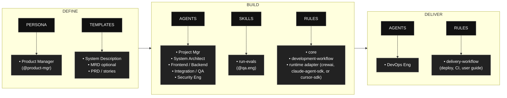

# AAMAD – AI-Assisted Multi-Agent Application Development Framework

**AAMAD** is an open, production-grade framework for building, deploying, and evolving multi-agent applications using best context engineering practices.  
It systematizes research-driven planning, modular AI agent workflows, and rapid MVP/devops pipelines for enterprise-ready AI solutions.

---

## Table of Contents

- [Overview](#overview)
  - [What is AAMAD?](#what-is-aamad)
  - [What AAMAD is not](#what-aamad-is-not)
  - [Principles and benefits](#principles-and-benefits)
  - [Core Concepts](#core-concepts)
  - [AAMAD phases at a glance](#aamad-phases-at-a-glance)
- [Getting Started](#getting-started)
  - [Installation](#installation)
  - [Initialization](#initialization)
  - [Multi-IDE support](#multi-ide-support)
    - [Cursor](#cursor)
    - [Claude Code](#claude-code)
    - [VS Code + GitHub Copilot](#vs-code--github-copilot)
    - [Kiro](#kiro)
  - [Runtime adapters](#runtime-adapters)
- [How to Use the Framework](#how-to-use-the-framework)
  - [Phase 0: Brownfield Review (System Architect)](#phase-0-brownfield-review-system-architect)
  - [Phase 1: Define Stage (Product Manager)](#phase-1-define-stage-product-manager)
  - [Phase 2: Build Stage (Multi-Agent)](#phase-2-build-stage-multi-agent)
  - [Phase 3: Deliver Stage (DevOps)](#phase-3-deliver-stage-devops)
- [Contributing](#contributing)
- [License](#license)

---

## Overview

### What is AAMAD?

AAMAD is a context engineering framework based on best practices in AI-assisted coding and multi-agent system development methodologies.  
It enables teams to:

- Launch projects with autonomous or collaborative AI agents
- Rapidly prototype MVPs with clear context boundaries
- Use production-ready architecture/design patterns
- Accelerate delivery, reduce manual overhead, and enable continuous iteration

In AAMAD, the development crew (personas, rules, templates, and artifacts) is the stable methodology.  
Runtime adapters are an implementation choice for what backend runtime your generated MVP targets.

You can use AAMAD across multiple development environments: see [Multi-IDE support](#multi-ide-support) for Cursor, Claude Code, VS Code + GitHub Copilot, and Kiro.

### What AAMAD is not

- AAMAD is not a programmatic runtime orchestrator for its own Define → Build → Deliver phases.
- Runtime adapter selection does not change AAMAD phase orchestration; it only changes the runtime conventions used by Build-phase implementation personas.
- Headless orchestration of AAMAD phases remains out of scope (see current release notes / changelog).

### Principles and benefits

AAMAD changes “vibe coding” from ad-hoc prompting into a **context-first, persona-driven** workflow:

- **Single-responsibility personas** own clear epics (Define → Build → Deliver) with explicit inputs, outputs, and prohibited actions.
- **Artifacts over chat memory:** PRD, SAD, and phase docs under `project-context/` make decisions auditable and reproducible.
- **Runtime adapters are an implementation choice** (`AAMAD_TARGET_RUNTIME`), not the methodology itself.
- **Quality gates** (required headings, optional `aamad validate`, QA → security → deliver) keep MVP scope honest.

**Benefits you can expect:** clearer requirements before code, less rework from underspecified prompts, traceable handoffs between agents, and documentation that stays useful when you re-sync after code changes.

### Core Concepts

- **Persona-driven development:** Each workflow is owned and documented by a clear AI agent persona with a single responsibility principle.
- **Context artifacts:** All major actions, decisions, and documentation are stored as markdown artifacts, ensuring explainability and reproducibility.
- **Quality gates:** Required artifact headings, optional `aamad validate`, and QA → evals → security → deliver sequencing.
- **Evals as acceptance criteria:** Measurable success thresholds (accuracy, latency, safety, security, cost) defined before Build in the SAD and implemented as a golden-dataset eval suite (`*run-evals`) that gates future model/prompt changes.
- **Project configuration:** Optional `aamad.config.yml` for shared language, UI, testing, and security preferences across personas.
- **Documentation sync:** After enhancing generated code, use `prompt-sync-docs` so `project-context/` stays aligned with the implementation.
- **Parallelizable epics:** Big tasks are broken into epics, making development faster and more autonomous while retaining control over quality.
- **Reusability:** Framework reusable for any project—simply drop in your PRD/SAD and let the agents execute.
- **Open, transparent, and community-driven:** All patterns and artifacts are readable, auditable, and extendable.

### AAMAD phases at a glance

AAMAD organizes work into three phases: Define, Build, and Deliver, each with clear artifacts, personas, and rules to keep development auditable and reusable. 
The flow begins by defining context and templates, proceeds through multi‑agent build execution, and finishes with operational delivery.



- **Phase 0 (Review, brownfield only):** System Architect (`@system.arch`) inspects the existing repo, writes `project-context/0.review/` artifacts, and an as-is SAD with proposed enhancements. The operator records an Operator Decision before Define.

- **Phase 1 (Define):** Product Manager persona (`@product-mgr`) conducts structured elicitation (recommended), optional MRD for commercial products, and PRD/user stories. On brownfield projects this is a **constrained Define**: PRD and stories cover only the approved enhancement set.

- **Phase 2 (Build):** Multi‑agent execution by Project Manager, System Architect, Frontend Engineer, Backend Engineer, Integration Engineer, QA Engineer (unit + integration stages), and (recommended) Security Engineer, governed by core/development-workflow rules and the selected runtime adapter rule.

- **Phase 3 (Deliver):** DevOps Engineer (`@devops.eng`) packages the validated MVP using the `delivery-workflow` rule; artifacts include `project-context/3.deliver/deploy.md` and optionally `user-guide.md`.

---

## Getting Started

### Installation

Requires Python 3.9+. Install the AAMAD CLI from PyPI:

```bash
pip install aamad
# or
uv pip install aamad
```

That installs the `aamad` command. It does not write project files until you run [Initialization](#initialization).

---

### Initialization

From the project root, run:

```bash
aamad init
```

In a terminal (TTY), init asks:

1. **Which development environment will you use the AAMAD dev crew on?** — Cursor, Claude Code, VS Code with GitHub Copilot, or Kiro
2. **Is this a greenfield or a brownfield project?** — start from scratch, or install into a repo that already has an ongoing project
3. **Which runtime adapter will this project use?** — asked only for greenfield. Choices are CrewAI, Claude Agent SDK, Cursor SDK, or **Choose this later**. A selected adapter writes `AAMAD_TARGET_RUNTIME` (and `runtime.target` in `aamad.config.yml`). Choosing later leaves the variable unset and prints that CrewAI will be used as the default if you do not set it later.

Pass flags to skip a prompt (required for `--ide` when stdin is not a TTY):

```bash
aamad init --ide cursor                 # still asks mode, then runtime when greenfield
aamad init --ide cursor --mode brownfield
aamad init --ide claude-code --mode greenfield --runtime crewai
aamad init --ide vscode --mode brownfield
aamad init --ide kiro --mode greenfield --runtime later
```

**CLI flags:**

- `--dest PATH` — Output directory (default: current directory)
- `--ide {cursor,claude-code,vscode,kiro}` — Target IDE. Omit to choose interactively.
- `--mode {greenfield,brownfield}` — Project spine. Omit to choose interactively; defaults to greenfield when not a TTY.
- `--runtime {crewai,claude-agent-sdk,cursor-sdk,later}` — Greenfield runtime adapter. Omit to choose interactively; skipped on brownfield. Non-TTY greenfield defaults to `later`.
- `--overwrite` — Allow replacing existing files
- `--dry-run` — Preview what would be written

Non-interactive runs without `--ide` exit 2. Init writes `project.mode` into `aamad.config.yml`. A chosen runtime also writes `AAMAD_TARGET_RUNTIME` in `.env` (and updates `.claude/settings.json` for Claude Code). Brownfield init also creates `project-context/0.review/` and leaves an existing `README.md` in place unless `--overwrite` is set.

When init finishes, the terminal prints suggested next actions for the chosen IDE and mode (brownfield starts at `@system.arch` / Phase 0; greenfield starts at `@product-mgr` / Phase 1). Init does not run the Review or Define agents itself.

Inspect bundle contents: `aamad bundle-info --verbose` or `aamad bundle-info --ide claude-code`. For `--ide vscode` and `--ide kiro`, artifacts are generated from the Cursor bundle (no separate bundle).

---

### Multi-IDE support

AAMAD supports **Cursor**, **Claude Code**, **VS Code + GitHub Copilot**, and **Kiro**. The framework produces the same artifacts (`project-context/`, templates, Phase 0 / Phase 1 prompts); only rules and agent scaffolding differ.

| Feature | Cursor | Claude Code | VS Code + Copilot | Kiro |
| :------ | :----- | :---------- | :---------------- | :--- |
| **Rules / instructions** | `.cursor/rules/*.mdc` with `alwaysApply: true` | `.claude/CLAUDE.md` + `.claude/rules/*.md` | `.github/instructions/*.instructions.md` | `.kiro/steering/*.md` with `inclusion: always` |
| **Rule format** | `.mdc` (YAML frontmatter + markdown body) | `.md` (plain markdown) | `.instructions.md` (`applyTo`, `name`, `description`) | `.md` (steering frontmatter + markdown body) |
| **Glob-based scoping** | Yes (`globs:` in frontmatter) | No (all rules loaded) | Yes (`applyTo:` in frontmatter) | Yes (`inclusion: fileMatch`; AAMAD rules use `always`) |
| **Agent definitions** | `.cursor/agents/*.md` | `.claude/agents/*.md` | `.github/agents/*.agent.md` | `.kiro/agents/*.md` |
| **Agent invocation** | `@agent-name` in chat | Delegation via `description`; explicit request | Agent dropdown; `@agent-name`; handoff buttons | Agent picker in the chat pane |
| **Tool enforcement** | Instructions-based | Hard allowlist/denylist | Tool allowlist in frontmatter | Tool list in agent frontmatter |
| **Phase 0 prompt** | `.cursor/prompts/prompt-phase-0-review` | `.claude/commands/phase-0-review.md` (slash command) | `.github/prompts/phase-0-review.prompt.md` | `.kiro/steering/phase-0-review.md` (manual steering / slash command) |
| **Phase 1 prompt** | `.cursor/prompts/prompt-phase-1` | `.claude/commands/phase-1-define.md` (slash command) | `.github/prompts/phase-1-define.prompt.md` | `.kiro/steering/phase-1-define.md` (manual steering / slash command) |
| **Skills** | `.cursor/skills/run-evals/` | `.claude/skills/run-evals/` (native skills) | `.github/prompts/run-evals.prompt.md` (bound to `qa-eng`; no native skills primitive) | `.kiro/skills/run-evals/` (native Agent Skills) |
| **Templates** | `.cursor/templates/` | `.claude/templates/` | `.github/templates/` | `.kiro/templates/` |
| **Project context** | `project-context/` (shared) | `project-context/` (shared) | `project-context/` (shared) | `project-context/` (shared) |
| **Bridge file** | `AGENTS.md` (root) | `AGENTS.md` (root) | `AGENTS.md` (root) | `AGENTS.md` (root) |

| What you do | Cursor | Claude Code | VS Code + Copilot | Kiro |
| :---------- | :----- | :---------- | :---------------- | :--- |
| **Start a fresh context** | `Cmd+Shift+P` → **New Chat** | `/clear` or start a new session | Start a new chat session | Start a new chat session |
| **Invoke a persona** | Type `@backend.eng` (or other agent) in chat | Ask to use the subagent by name, or refer to its description | Pick the agent from the dropdown, or use `@agent-name` | Pick the agent from the chat pane picker |
| **Reference a file** | `@path/to/file` in chat | `@path/to/file` in the prompt | `#file:path/to/file` or drag-and-drop the file | `#file` references or attach from the workspace |
| **Phase transitions** | Switch persona manually in chat | Use subagent chaining or explicit instructions | Use **handoff** buttons in the chat UI (when configured) | Switch persona from the agent picker |

| Capability | Cursor | Claude Code | VS Code + Copilot | Kiro |
| :--------- | :----- | :---------- | :---------------- | :--- |
| **AAMAD support** | Native | Via `aamad init --ide claude-code` | Via `aamad init --ide vscode` | Via `aamad init --ide kiro` |
| **Agent handoffs** | Manual | Manual or subagent chaining | Native UI buttons (Define → Build → Deliver) | Manual (agent picker) |
| **Parallel work** | Multiple chat tabs | Subagents / Agent Teams | Subagents | Workflows / custom agents |
| **Model choice** | Multi-model | Claude models | Multi-model (GPT, Claude, Gemini, etc.) | Multi-model |
| **Best for** | AAMAD as designed | CLI-first, solo use | Teams, enterprise, model diversity | Spec-driven and steering-first workflows |

These are the same in every IDE: `project-context/` (Phase 0/1/2/3 outputs), templates (stored in the IDE folder), Phase 0 / Phase 1 prompt content, crew methodology, and git/dependency setup. What changes is where rules, agents, and templates live and how you invoke personas.

Upgrading a Claude Code, VS Code, or Kiro project from 0.9.0 or earlier: `aamad init --overwrite --ide <claude-code|vscode|kiro>`. If the project is not using Cursor, delete leftover `.cursor/` afterward.

#### Cursor

Initialize after [Installation](#installation):

```bash
aamad init --ide cursor --dest .
```

**Folder structure after init:**

```
your-project/
├── .cursor/
│   ├── agents/          # Persona definitions (@product-mgr, @backend.eng, etc.)
│   ├── prompts/         # Phase-specific prompts (prompt-phase-0-review, prompt-phase-1)
│   ├── rules/           # Always-on rules (*.mdc)
│   ├── skills/          # Agent skills (e.g. run-evals)
│   └── templates/      # PRD, SAD, brownfield review templates
├── project-context/
│   ├── 0.review/        # Brownfield only: current-state, docs, architecture backlog
│   ├── 1.define/        # MRD, PRD, SAD outputs
│   ├── 2.build/         # setup.md, frontend.md, backend.md, etc.
│   └── 3.deliver/       # deploy runbook and configs
├── AGENTS.md            # Bridge file (IDE discoverability)
├── CHECKLIST.md
└── README.md
```

Invoke a persona with `@backend.eng` (or another agent) in chat. Reference files with `@path/to/file`. Start a fresh module with `Cmd+Shift+P` → **New Chat**.

#### Claude Code

Initialize after [Installation](#installation):

```bash
aamad init --ide claude-code --dest .
```

**Folder structure after init:**

```
your-project/
├── .claude/
│   ├── CLAUDE.md        # Rules summary + cross-references
│   ├── agents/          # Persona definitions (Claude Code format)
│   ├── commands/        # Slash commands (phase-0-review, phase-1-define)
│   ├── rules/           # Individual rule files (*.md)
│   ├── skills/          # Agent skills (e.g. run-evals, native Claude Code skills)
│   ├── templates/       # PRD, SAD, brownfield review templates
│   └── settings.json    # Permissions, AAMAD_TARGET_RUNTIME env
├── project-context/
│   ├── 0.review/        # Brownfield only
│   ├── 1.define/
│   ├── 2.build/
│   └── 3.deliver/
├── AGENTS.md
├── CHECKLIST.md
└── README.md
```

Ask Claude to use a subagent by name or description. Phase 0 / Phase 1 are `/phase-0-review` and `/phase-1-define`. Reference files with `@path/to/file`. Start a fresh context with `/clear` or a new session.

#### VS Code + GitHub Copilot

**Required extensions:** GitHub Copilot, GitHub Copilot Chat. Recommended: Python (ms-python), YAML (redhat).

Initialize after [Installation](#installation):

```bash
aamad init --ide vscode --dest .
```

**Folder structure after init:**

```
your-project/
├── .github/
│   ├── instructions/   # Copilot instructions (*.instructions.md)
│   ├── agents/         # Custom agents (*.agent.md) with optional handoffs
│   ├── prompts/        # Phase 0/1, sync-docs, run-evals
│   └── templates/      # PRD, SAD, brownfield review templates
├── .vscode/
│   └── settings.json   # chat.instructionsFilesLocations, chat.agentFilesLocations
├── project-context/
│   ├── 0.review/        # Brownfield only
│   ├── 1.define/
│   ├── 2.build/
│   └── 3.deliver/
├── AGENTS.md
├── CHECKLIST.md
└── README.md
```

Pick the agent from the dropdown or use `@agent-name`. Use **handoff** buttons for Define → Build → Deliver when they appear. Reference files with `#file:path/to/file` or drag-and-drop.

#### Kiro

Initialize after [Installation](#installation):

```bash
aamad init --ide kiro --dest .
```

**Folder structure after init:**

```
your-project/
├── .kiro/
│   ├── agents/          # Persona definitions (Kiro custom agents)
│   ├── steering/        # Always-on rules + manual Phase 0 / Phase 1 / sync-docs prompts
│   ├── skills/          # Agent skills (e.g. run-evals)
│   └── templates/       # PRD, SAD, brownfield review templates
├── project-context/
│   ├── 0.review/        # Brownfield only
│   ├── 1.define/
│   ├── 2.build/
│   └── 3.deliver/
├── AGENTS.md
├── CHECKLIST.md
└── README.md
```

Switch personas from the agent picker in the chat pane. Manual steering files (`phase-0-review`, `phase-1-define`, `sync-docs`) appear as slash commands.

---

### Runtime adapters

Use `AAMAD_TARGET_RUNTIME` to choose the runtime target for the generated multi-agent application in Phase 2. Greenfield `aamad init` can set this when you pick an adapter; “choose this later” leaves CrewAI as the default until you set the variable.

| Runtime | Status | Best fit |
| :------ | :----- | :------- |
| `crewai` | Default | Declarative task orchestration with YAML-first runtime configuration |
| `claude-agent-sdk` | Supported | Agentic runtime harness with hooks, MCP, and session control |
| `cursor-sdk` | Supported | TypeScript-first Cursor runtime integration with explicit tool/runtime contracts |

---

## How to Use the Framework

1. **[Install](#installation)** the CLI, then **[initialize](#initialization)** the project (`aamad init`). Choose an IDE, greenfield vs brownfield, and (on greenfield) a runtime adapter or “choose this later.” Follow the next-steps printed in the terminal; init does not run agents.
2. **Confirm the IDE layout** in [Multi-IDE support](#multi-ide-support). Adjust `aamad.config.yml` if you need language, UI, testing, or security preferences (`project.mode` is already set).
3. **Confirm `AAMAD_TARGET_RUNTIME`** before Build-phase implementation. Greenfield init may have already set it; if you chose later, CrewAI is the default until you set `crewai`, `claude-agent-sdk`, or `cursor-sdk`. See [Runtime adapters](#runtime-adapters).
4. **Run the spine for your mode** (details in the phase sections below and in `CHECKLIST.md`):
   - **Greenfield:** [Phase 1 Define](#phase-1-define-stage-product-manager) (`@product-mgr`) → SAD (`@system.arch`) → [Phase 2 Build](#phase-2-build-stage-multi-agent) → [Phase 3 Deliver](#phase-3-deliver-stage-devops).
   - **Brownfield:** [Phase 0 Review](#phase-0-brownfield-review-system-architect) (`@system.arch` `*review-codebase` then `*create-sad`) → operator records the SAD Operator Decision → constrained [Phase 1](#phase-1-define-stage-product-manager) (approved enhancements only) → Build → Deliver. Do not scaffold a replacement app.
5. **Validate at each gate:** `aamad validate --phase review` (brownfield), then `--phase define`, `--phase build`, and `--phase deliver`.
6. **Keep docs aligned** after code changes: Cursor `.cursor/prompts/prompt-sync-docs`, Claude Code `/sync-docs`, VS Code `sync-docs` prompt, Kiro `/sync-docs`.

### Phase 0: Brownfield Review (System Architect)

When `project.mode` is `brownfield`, start here instead of a blank-slate Define. `@system.arch` follows `.cursor/rules/brownfield-review.mdc` (REA-style evidence rules):

- `*review-codebase` writes `project-context/0.review/current-state.md`, `documentation.md`, and `architecture-backlog.md`
- `*create-sad` writes an as-is SAD plus a **Proposed Enhancements** chapter and an **Operator Decision** section
- The operator sets Operator Decision to `approved`, `approved-with-changes`, or `rejected`
- Run `aamad validate --phase review` after the SAD exists

Do not overwrite the existing project README. Architecture backlog items are structural only — not bug fixes.

### Phase 1: Define Stage (Product Manager)

The Product Manager persona (`@product-mgr`) conducts discovery and context setup to standardize project scoping:

- **Brownfield:** wait for Operator Decision `approved` or `approved-with-changes`. Write a PRD and stories only for the approved enhancements. Skip MRD unless asked.
- **Elicitation (recommended on greenfield):** Structured questionnaire → `system-description.md` via `*elicit-requirements`
- **Market Research (optional):** MRD using the `mrd-template.md` in your IDE templates folder for commercial products; skip for internal/personal tools and for brownfield by default
- **Requirements:** PRD using the `prd-template.md` in your IDE templates folder
- **User stories:** MVP stories for architecture and QA traceability
- **Project config:** `aamad.config.yml` for mode, language, UI, testing, and security defaults
- **Validation:** Run `aamad validate --phase define` when artifacts exist

Phase 1 outputs are stored in `project-context/1.define/` and provide the foundation for all subsequent development phases.

### Phase 2: Build Stage (Multi-Agent)

Each role is embodied by an agent persona, defined in `.cursor/agents/` (Cursor), `.claude/agents/` (Claude Code), or `.github/agents/` (VS Code).  
Before implementation, confirm `AAMAD_TARGET_RUNTIME` (`crewai` default if unset, `claude-agent-sdk` supported, `cursor-sdk` supported). Greenfield init can set this when you pick an adapter.
Phase 2 is executed by running each epic in sequence after completing Phase 1:

- **Architecture:** Greenfield generates `sad.md`; brownfield already has an as-is SAD from Phase 0. Fill eval criteria via `*define-eval-criteria` after a PRD exists.
- **Setup:** Scaffold environment, install dependencies, and document (`setup.md`)
- **Frontend:** Build UI + placeholders, document (`frontend.md`)
- **Backend:** Implement backend for the selected runtime, document (`backend.md`)
- **Integration:** Wire up chat flow, verify, document (`integration.md`)
- **Quality Assurance:** Run `*test-unit` and `*test-integration`, then smoke/acceptance (`*qa`); map tests to acceptance-criteria IDs when present; log in `qa.md`
- **Evals (recommended):** `*run-evals` — golden dataset, code-based checks, LLM-as-judge scoring, and production monitoring recommendations for DevOps; logged in `evals.md`. Already past QA on an existing project? Run `*run-evals` directly — it asks you for any missing thresholds instead of blocking (see `.cursor/skills/run-evals/`).
- **Security (recommended):** `@security.eng` → `security.md` before Deliver (required when `aamad.config.yml` sets `security.require_security_assessment: true`)

Artifacts are versioned and stored in `project-context/2.build` for traceability.

### Phase 3: Deliver Stage (DevOps)

After QA (and preferably security), invoke `@devops.eng`:

- **Release readiness:** Confirm `qa.md` (and note `evals.md` and `security.md` status)
- **Deploy / CI:** Minimal deploy and pipeline config aligned with SAD and `AAMAD_TARGET_RUNTIME`, incorporating `evals.md`'s Production Monitoring Recommendations (trace fields, dashboards, alert thresholds)
- **Runbook:** `project-context/3.deliver/deploy.md` (hosting, env matrix, access, rollback)
- **User docs:** `*document-user-guide` → `project-context/3.deliver/user-guide.md`
- **Validate:** `aamad validate --phase deliver`

---

## Contributing

Contributions are welcome!  
- Open an issue for bugs/feature ideas/improvements.
- Submit pull requests with extended templates, new agent personas, or bug fixes.
- Help evolve the knowledge base and documentation for greater adoption.
- When modifying `.cursor/` or `project-context/`, run `python scripts/update_bundle.py` to refresh both Cursor and Claude Code bundles before publishing.

---

## License

Licensed under Apache License 2.0.

> Why Apache-2.0
>    Explicit patent grant and patent retaliation protect maintainers and users from patent disputes, which is valuable for AI/ML methods, agent protocols, and orchestration logic.
>    Permissive terms enable proprietary or closed-source usage while requiring attribution and change notices, which encourages integration into enterprise stacks.
>    Compared to MIT/BSD, Apache-2.0 clarifies modification notices and patent rights, reducing legal ambiguity for contributors and adopters.

---

> For detailed step-by-step Phase 2 execution, see [CHECKLIST.md](CHECKLIST.md).  
> For advanced reference and prompt engineering, see the templates and rules folders for your IDE.
